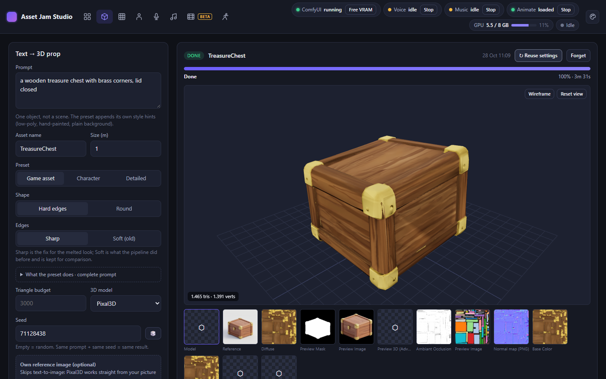
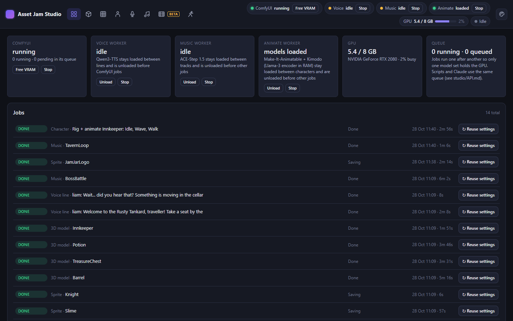
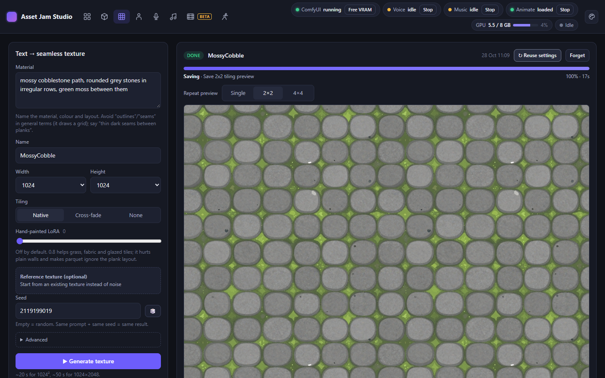
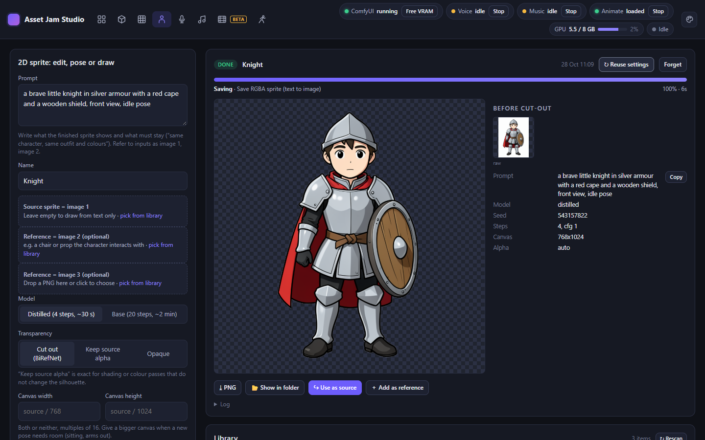
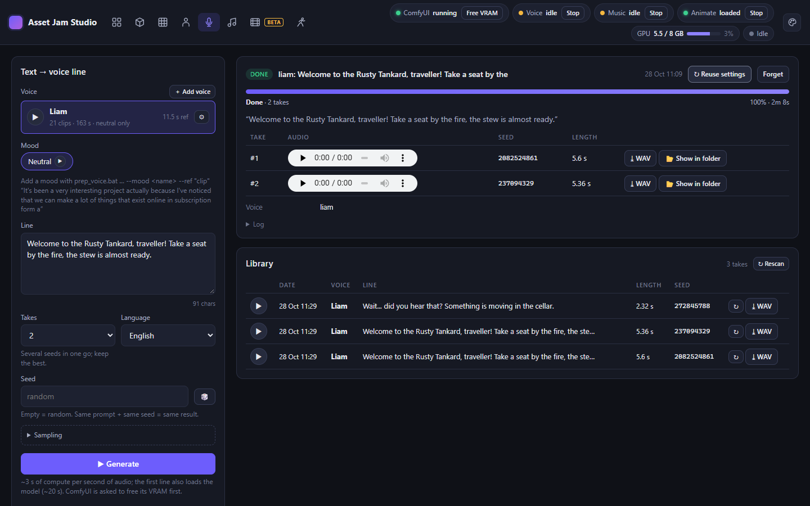
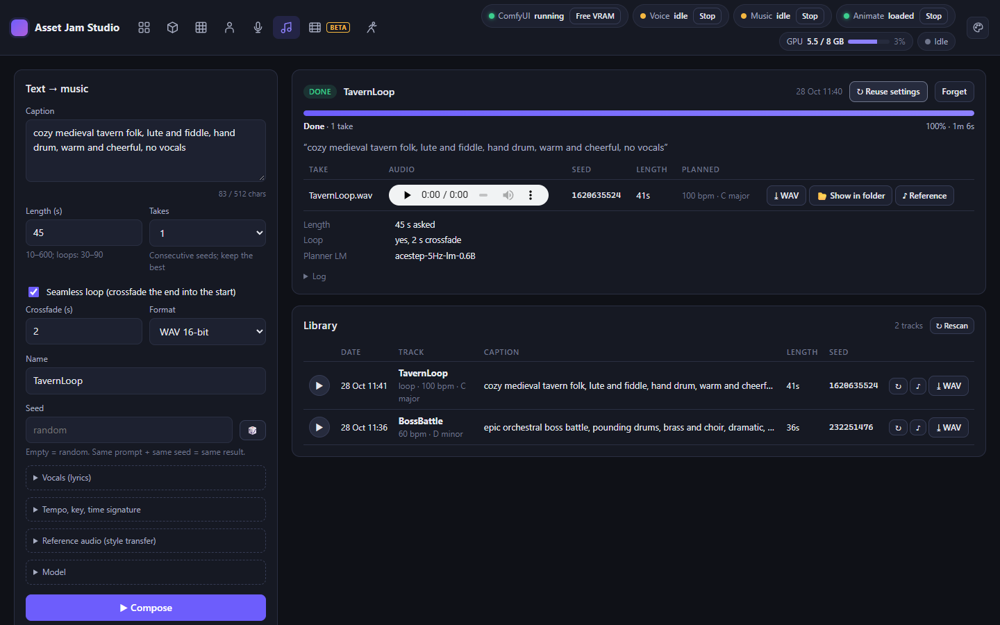
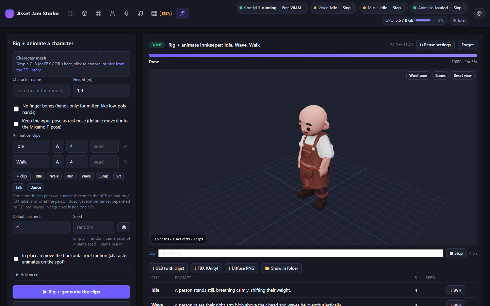

# Asset Jam Studio

A local, offline game-asset studio: 3D props, seamless textures, 2D sprites, voice lines, music, sound
effects, intro videos and rigged, animated characters from text, all on your own GPU.

## Why

The goal is a fully local, actually usable setup for making every kind of asset a video game needs, without
depending on subscription services. Everything here runs on your own machine: no cloud generation, no
credits, no accounts (except a free Hugging Face login for one optional model), and nothing stops working when
a service changes its pricing or shuts down. Every model was picked for output quality on consumer hardware
and for weights that may be used in a commercial game (see Licences below).

Windows only (`.ps1` setup, `.bat` CLIs) and NVIDIA only. Every setting was tuned on one RTX 2080 with 8 GB of
VRAM; a bigger card runs it as is, and if you want to use the extra VRAM (bf16, larger models, fewer offloads),
ask your LLM to adapt the settings for your GPU.

**Installing: follow [`SETUP.md`](SETUP.md)** (written so an LLM coding agent can run it for you).

| Folder | What | Models |
|---|---|---|
| [`ai-3d/`](ai-3d/README.md) | text → low-poly 3D props (GLB + Unity FBX), seamless world textures, 2D sprite edit/pose/generation | Z-Image-Turbo, Pixal3D / TRELLIS.2, FLUX.2 klein 4B, BiRefNet, MoGe-2 in ComfyUI |
| [`ai-voc/`](ai-voc/README.md) | text → dialogue in an actor's voice, with moods and optional fine-tuning | Qwen3-TTS 1.7B-Base, Whisper large-v3-turbo |
| [`ai-mus/`](ai-mus/README.md) | text → game music (instrumental or sung), seamless loops, 48 kHz stereo | ACE-Step 1.5 (2B turbo DiT + 0.6B planner LM) |
| [`ai-sfx/`](ai-sfx/README.md) | text → sound effects (explosions, gunshots, footsteps, UI sounds, ambience loops), 48 kHz mono | MOSS-SoundEffect v2.0 (1.3B DiT + Qwen3-1.7B text encoder) |
| [`ai-vid/`](ai-vid/README.md) | shot list → logo intros / short videos: Wan 2.2 clips chained through keyframes, logo reveal from the PNG, ffmpeg cross-fades + music | Wan 2.2 TI2V-5B, FLUX.2 klein (keyframes) in the ai-3d ComfyUI |
| [`ai-anim/`](ai-anim/README.md) | humanoid mesh → rigged character (Mixamo skeleton) + animation clips from text: GLB with glTF animations + Unity FBX | Make-It-Animatable, NVIDIA Kimodo-SOMA-RP (Llama-3 text encoder on the CPU), Blender |
| [`studio/`](studio/README.md) | browser front-end for all of the above: one queue, live progress, libraries; the same queue as an HTTP API + CLI ([`studio/API.md`](studio/API.md)) | — |

Daily use: `studio/studio.bat` (browser UI), or the `.bat` CLIs in each folder.

## Screenshots

All assets below were generated by the studio on an RTX 2080.

| | |
|---|---|
|  **Overview**: one queue for every generator, live GPU and worker status |  **Textures**: seamless world textures, previewed tiled |
|  **Sprites**: draw, edit or re-pose 2D characters, cut out to RGBA |  **Voice**: dialogue in a cloned voice, several takes per line |
|  **Music**: instrumental or sung tracks and seamless loops |  **Animate**: rig a character and animate it from text |

Claude as a user of the toolkit: with the studio running, the skill in `.claude/skills/asset-jam-studio/` lets a
Claude Code session generate any of these assets through `studio/studio_cli.py` (queue, wait, pick up the files).
Copy the skill folder to `%USERPROFILE%\.claude\skills\` to use it from another project.

Research notes and open ideas live in [`todo/`](todo/README.md); they are background, not instructions.

## Licences

The toolkit's own code is licensed under the **GNU GPL v3** ([`LICENSE`](LICENSE)). Parts of it patch or plug
into ComfyUI (GPL-3.0), so the whole repo uses the same licence to keep that simple. The GPL covers this code
only: it does **not** apply to the models, which are downloaded from their own publishers under their own
licences, nor to the assets you generate with them.

Third-party code included here, under its own (GPL-compatible) licence:

| Path | From | Licence |
|---|---|---|
| `ai-3d/custom_nodes/ai3d_seamless/` | latent-rolling method adapted from Oliver Crosby's ComfyUI-Universal-Seamless-Tiles | MIT (its `LICENSE`) |
| `ai-anim/vendor/pytorch3d/` | a copy of PyTorch3D's pure-Python `transforms` package, Meta Platforms | BSD-3-Clause (its `LICENSE`) |
| `ai-3d/patches/comfyui-turing-fp16.patch` | a patch to ComfyUI | GPL-3.0 |

Setup also clones ComfyUI (GPL-3.0), ACE-Step 1.5 (MIT), Make-It-Animatable (MIT) and NVIDIA Kimodo
(Apache-2.0) into git-ignored folders; they are not redistributed here.

**Not legal advice.** The licence tables in each module's README and the claim that outputs may ship in a
commercial game are the author's reading of each model's licence at the time of writing. Licences change and
some carry conditions (for example the Meta Llama 3 Community License behind ai-anim's text encoder has
attribution and naming requirements, and some models exclude certain regions or revenue levels). Check every
model's current licence yourself before you ship anything made with it.
